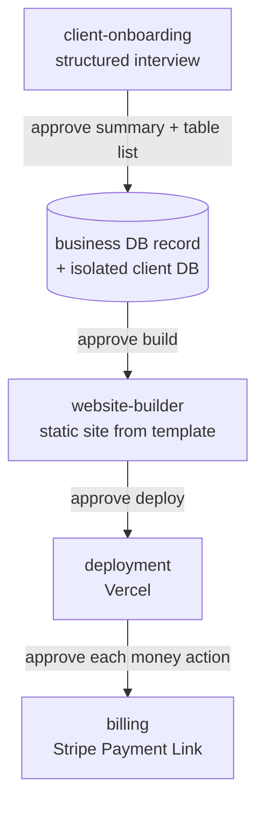

# Agency System — AI agents from client brief to deployed site

A multi-agent system built with [Claude Code](https://claude.com/claude-code) that takes a client brief to a deployed static site with a Stripe payment link.
A hands-on project in designing reliable, permission-scoped AI agent workflows, structured the way a small web agency would run delivery.
It has been run end to end on test clients only.

## How it works

The `/newclient` command starts the pipeline. Each arrow is a human approval gate.



## The four agents

Definitions are in [`.claude/agents/`](.claude/agents/) (written in Hebrew).

| Agent | Responsibility | Key rule |
|---|---|---|
| `client-onboarding` | Interviews the operator (the person running the agency) and decides template, DB and billing needs. | Closed questions only; nothing is created before the summary is approved. |
| `website-builder` | Builds a static site from a shared template. | Customizes every template and never invents business details. |
| `deployment` | Deploys to Vercel and records the deploy in the business DB. | The Vercel token comes from `.env` and is never printed. |
| `billing` | Adds a Stripe checkout to the site. | Client's own Stripe account only; tests used a shared sandbox under an explicit exception (see limitations). |

## Design decisions

**Two kinds of database.** One business DB tracks the agency's clients, projects, invoices and deployments.
Each client that needs dynamic data gets its own isolated Supabase project.
This keeps client data and agency data apart, and removing a client means deleting one project.

**RLS by default.** Every client table has Row Level Security enabled from creation.
Only catalog tables (products, categories) get a public read-only policy; customers and orders are server-side only.

**Keys and scope:**

| Key | Scope and location |
|---|---|
| Supabase org token | Creates and deletes projects; root `.env` |
| Supabase service-role key | Full access to one project; root or client `.env` |
| Vercel token | Deploys any site; root `.env` |
| Stripe secret key | The client's own account; client `.env` |

- **Secrets** live only in gitignored `.env` files (names in [`.env.example`](.env.example)).
- **Approval gates** come before creating a DB, before any billing action and before any deploy (`vercel deploy` always asks, via [`.claude/settings.json`](.claude/settings.json)).
- **Deploy hygiene:** every site and template has a `.vercelignore` that keeps `db/`, `.env*` and `.gitignore` out of the deploy.

## Tech stack

Claude Code subagents · static HTML + Tailwind (CDN) · Supabase (Postgres + RLS) · Vercel CLI · Stripe test mode.

## Project structure

```
.claude/   # agents, /newclient command, skill, permission settings
db/        # business DB schema
docs/      # project plan (Hebrew)
sites/     # shared templates + one folder per client
CLAUDE.md  # project rules for Claude Code (Hebrew)
```

## Run it yourself

You need Claude Code plus Supabase (with an org access token), Vercel and Stripe (test mode) accounts.
Copy `.env.example` to `.env` and fill it in.
Open the project in Claude Code and run `/newclient`.
Note: the agent prompts are written in Hebrew.

## Status and next steps

Tested end to end on a test client: interview, DB setup with RLS, site build, Vercel deploy and Stripe test checkout.
There are no real clients yet.

- Static sites only: checkout is a single Stripe Payment Link, not a dynamic cart.
- No Stripe webhook yet, so payments are not written back to the client's `orders` table.
- Stripe tests used a shared sandbox account, not one account per client.
- Vercel is the only deploy target; Netlify, Docker/VPS and Tranzila are not built.
- The `invoices` table exists, but no agent writes to it yet.
- Supabase Free allows 2 active projects and pauses idle ones, so more clients or a live site need a paid plan.

More detail: [`CLAUDE.md`](CLAUDE.md) and [`docs/project-plan.md`](docs/project-plan.md) (both in Hebrew).

License: MIT
