# Agency System — AI agents that take a client brief to a deployed site

A multi-agent system built with [Claude Code](https://claude.com/claude-code) that runs a small web agency's delivery pipeline: interview → site → deploy → payments. Four specialized agents take a new client from a structured brief to a static site deployed on Vercel with a Stripe Payment Link. A human approves every step that creates infrastructure, deploys, or touches money.

The project serves two purposes: a working tool for a real (small) web business, and hands-on practice in designing reliable, permission-scoped AI agent workflows.

## How it works

A new client project starts with the `/newclient` slash command. The agents run one at a time, and the pipeline stops at each gate until the operator explicitly approves.

```mermaid
flowchart LR
    A(["/newclient"]) --> B[client-onboarding<br/>structured interview]
    B --> G1{{Gate: approve summary<br/>+ exact table list}}
    G1 -->|approved| C[(Register client in business DB<br/>+ create isolated client DB)]
    C --> G2{{Gate: approve build}}
    G2 --> D[website-builder<br/>static site from template]
    D --> G3{{Gate: approve deploy}}
    G3 --> E[deployment<br/>Vercel + deployments record]
    E --> G4{{Gate: approve billing plan<br/>and each money action}}
    G4 --> F[billing<br/>client's own Stripe account]
    F --> G5{{Gate: approve commit<br/>+ redeploy}}
```



- `client-onboarding` runs in the main session, not as a subagent. Claude Code removes the `AskUserQuestion` tool from subagents, and this agent must ask closed, multiple-choice questions rather than free text.
- Any action that changes money or checkout code needs explicit approval **before execution**, not just before planning. Billing changes are never auto-committed.

## The four agents

Definitions live in [`.claude/agents/`](.claude/agents/). Their prose is written in Hebrew.

| Agent | Responsibility | Key rule |
|---|---|---|
| `client-onboarding` | Interviews the operator (not the end client) to decide template, database needs and payment needs. After approval, registers the client in the business DB and provisions an isolated Supabase project for the client if needed. | Closed questions only. Shows a full summary, including every table to be created, and stops until it is explicitly approved. RLS is enabled on every new table. |
| `website-builder` | Builds a static HTML + Tailwind site by copying and customizing a shared template (`landing` or `ecommerce`). | A template is a skeleton, never the product: content, brand colors and tone are customized per client. It doesn't invent business details; missing content becomes clearly marked placeholders. It adds no database or payment code. |
| `deployment` | Deploys static sites to Vercel and records each deploy in the business DB's `deployments` table. | The Vercel token is always passed explicitly from `.env` and never printed. It doesn't touch billing or client databases. |
| `billing` | Connects the **client's own** Stripe account and adds a checkout section to the site. | Never the operator's account. It needs explicit approval before any money-related action, and never commits on its own. |

## Architecture: two kinds of database

| | Business DB | Per-client DB |
|---|---|---|
| Owner | The agency itself (exactly one) | One per client, only if the site is dynamic (shop, orders) |
| Tables | `clients`, `projects`, `invoices`, `deployments` ([schema](db/business-schema.sql)) | Decided at onboarding, e.g. `products`, `categories`, `customers`, `orders`, `order_items` |
| Where | One Supabase project | A **separate, isolated** Supabase project under the agency's org; schema kept in `sites/<client>/db/` |

**Why:** client business data (products, orders, customers) and the agency's own data (clients, projects, billing) are different concerns with different owners. Keeping them in separate projects means a client's data is never mixed into the agency's DB, or the reverse. A client can also be removed by deleting a single project.

## Security model

- **Row Level Security everywhere.** Every table in a client DB has RLS enabled from creation. Public access is granted only through narrow read-only policies where needed (for example `select` on the product catalog). Sensitive tables (customers, orders) have no public policy and are reachable only with the service-role key.
- **Keys, their scope, and where they live:**

  | Key | Scope | Lives in |
  |---|---|---|
  | Supabase org access token + org ID | Organization-wide: creates and deletes whole Supabase projects | root `.env` |
  | Supabase service-role key (`sb_secret_…` format) | One project, full access, bypasses RLS; server side only | root `.env` (business DB), `sites/<client>/.env` (client DB) |
  | Supabase publishable key | Public by design, safe only because of RLS; not used yet (sites are static) | — |
  | Vercel token | Account-wide: can deploy any site | root `.env` |
  | Stripe secret key | The client's own Stripe account | `sites/<client>/.env` |

- **Secrets only in gitignored `.env` files.** Secrets are never written to code, logs, temp files or scratch files, not even briefly. A value needed for one command is passed only through that command's environment. See [`.env.example`](.env.example) for the variable names.
- **Deploy hygiene.** Each site has a `.vercelignore` that keeps `db/`, `.env*` and `.gitignore` out of the deployed bundle.
- **Human approval gates** before creating databases, before any billing or money action, and before deploys. `vercel deploy` always prompts for approval through an `ask` rule in [`.claude/settings.json`](.claude/settings.json).

## Tech stack

- **Agents:** Claude Code subagents (`.claude/agents/*.md`) plus a project slash command (`/newclient`) and a project skill
- **Sites:** static HTML + Tailwind CSS via CDN, no build step; RTL/Hebrew support
- **Databases:** Supabase (Postgres + RLS), provisioned through the Supabase Management API
- **Hosting:** Vercel (CLI and REST API)
- **Payments:** Stripe (Products, Prices, Payment Links) in test mode

## Project structure

```
.claude/
  agents/          # the four agent definitions
  commands/        # /newclient slash command
  skills/          # project skill (Hebrew/English bidi text rules)
  settings.json    # permission rule: ask before any vercel deploy
db/
  business-schema.sql
docs/
  project-plan.md  # goals, DB architecture, security model, limitations
sites/
  _template-landing/     # shared landing-page template
  _template-ecommerce/   # shared shop template
  <client>/              # one folder per client: index.html, db/schema.sql, .env (gitignored)
CLAUDE.md          # project instructions and conventions for Claude Code
```

## Status and honest limitations

**Implemented and tested end to end:** onboarding interview → business-DB registration → isolated client DB with RLS → static shop site from a template → Vercel deploy with a DB record → Stripe test-mode checkout, run on a test client. The repo currently has two test sites and no real paying clients.

**Not implemented:**
- **Static sites only.** There is no backend, so the shop's cart is UI only. Checkout is a single static Stripe Payment Link for a fixed sample cart, not a dynamic cart.
- **Stripe runs in test mode only, with no webhooks.** Payments aren't written back to the client DB's `orders` table. Testing used a shared Stripe sandbox account, not a separate account per client.
- **Vercel is the only deployment target.** The booking template is planned but not built.
- **The billing model is planned, not implemented.** The business DB's `invoices` table exists, but no agent writes to it.
- **Supabase Free plan limits.** It allows 2 active projects and pauses idle ones, so more clients or a real live site need a paid plan.

## Roadmap

- Replace the overwrite-only `projects.notes` field with an append-only `project_updates` history table.
- Tighten the public product-catalog RLS policy (specific columns only, hide out-of-stock items) once there is real inventory.
- Add a Stripe webhook (`checkout.session.completed`) that writes real orders into the client's `orders` table when moving from static Payment Links to a dynamic shop.
- Add more deployment targets and payment providers (Netlify, Docker/VPS, Tranzila).

## More detail

Project conventions, workflow rules and current status are in [`CLAUDE.md`](CLAUDE.md), and the design background is in [`docs/project-plan.md`](docs/project-plan.md). Both are written in Hebrew.
